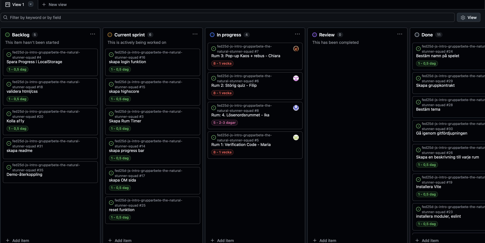

# Daily Standup: veckodag 2026-02-24

Dagens scrum master: Maria Birath

## Namn: Filip Brandt
- börjat med ts, fortsätter med sitt rum
- Tar uppgifter från current sprint i mån av tid
- Inga problem, behöver ingen hjälp, lärt sig något

## Namn: Chiara Jukkola
- Fortsätter med sitt rum har löst popup problemet
- Tar uppgifter från current sprint i mån av tid
- Hade ett problem med vite som löst sig
- Behöver ingen hjälp
- Lärt sig lösa problem med vite

## Namn: Maria Birath
- Jobbar vidare med sitt rum
- Fortsätter med sitt eget rum
- Tar uppgifter från current sprint i mån av tid
- Inga problem
- Behöver ingen hjälp
- Lärt sig -- 

## Namn: Ika Ossler
- Jobbar vidare med sitt rum, jobbat med css, gjorde timer i sitt rum
- Tar uppgifter från current sprint i mån av tid
- Problemfri
- Lärt sig göra en timer
- Behöver ingen hjälp

## Sprintplan

