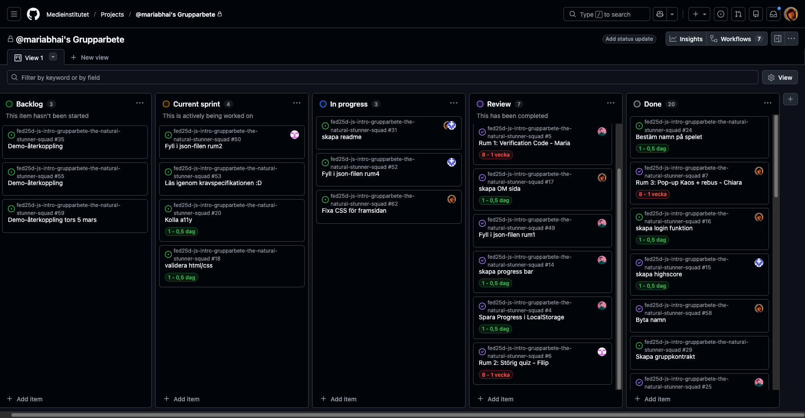

# Daily Standup: Måndag 2026-03-09

### Dagens scrum master: Kicki 

## Maria Birath
Sedan fredag 6 mars har Maria kollat igenom localstorage och fixat med timern till localstorage
Det har inte dykt upp några problem för maria. Och hon behöver i dagsläget inte hjälp med något.
De maria har lärt sig är localstorage

## Ika Ossler
Sedan i fredags har Ika jobbat med CSS på framsidan och försökt koppla json filen.
Ika har lite problem med att beskrvningen från json filen inte visas. Hon behöver inte direkt hjälp med något.
De Ika har lärt sig är att när man lägger in backgrundsöjud på en sida sen behöver den en klickfunktion då många webbläsare blockar ljud om den inte har den funktionen för de kan annars anses som störigt

## Chiara Jukkola
Sedan i fredags har Kicki fixat buggar som uppståt i spelet som tillexempel popup rutor som inte rensades efter rum 3 va klart utan fortsatte synas i både rum 4 när man tryckte på knappen "nästa rum" men även när man hamnade tillbaka i rum 1 igen. De Kicki har problem med är att about texten inte visas när man klickar på knappen "about". Kicki behöver inte hjälp med något. Kicki har lärt sig en hel del men kan inte riktigt sätta fingret på vad.

## Filip Brandt
Filip var frånvarande detta möte men det hade han meddelat i vår gruppchatt sedan tidigare.